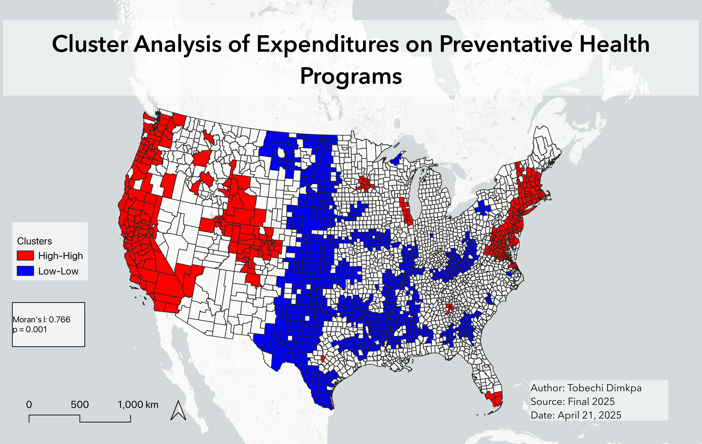
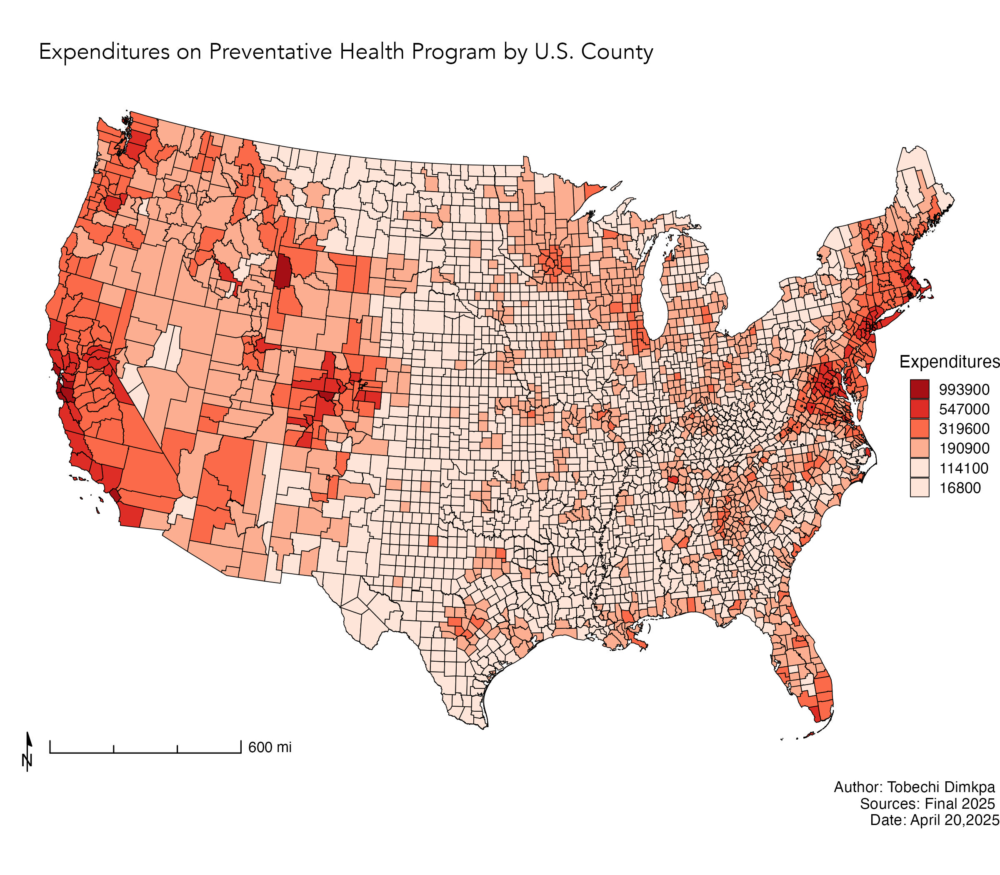
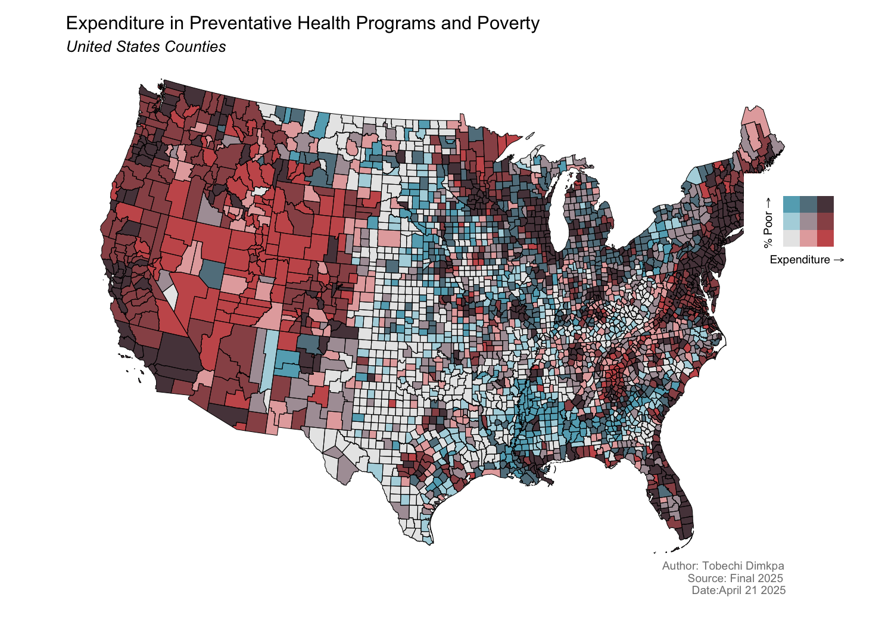
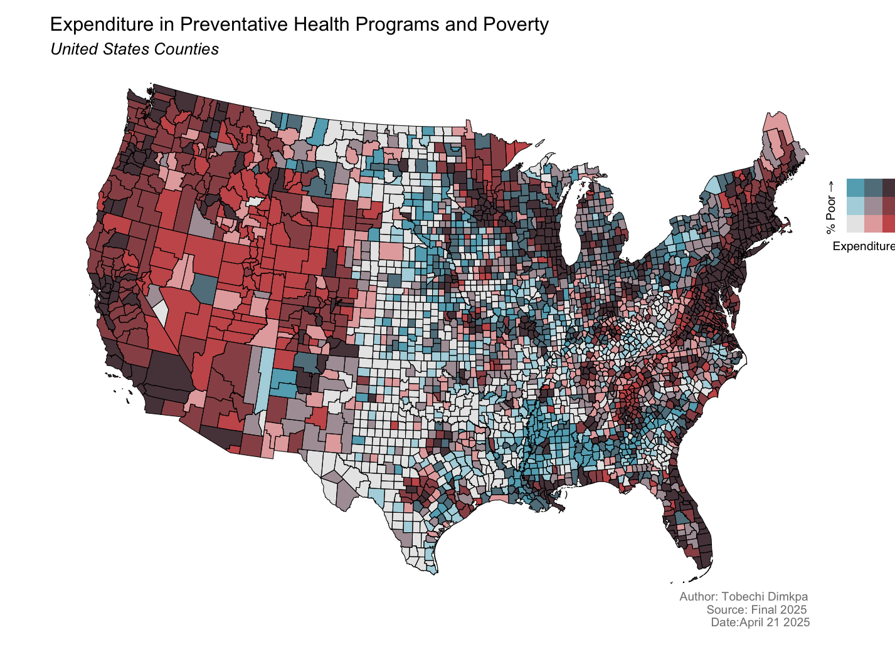

# Preventative Health Spending Across U.S. Counties

Spatial analysis of how much U.S. counties spend on preventative health programs, where that spending clusters, and how it relates to poverty and other county characteristics.

## Research question

How do expenditures on preventative health programs vary across U.S. counties? Is spending spatially clustered, and what county characteristics are associated with higher spending?

## Data

- **Unit of analysis:** U.S. counties (3,108 counties, per the regression output in `final.R`).
- **Variables** (from the county shapefile `US_CTY_PreventativeHealthExp.shp`):
  - `PHlth_Exp` — expenditures on preventative health programs
  - `PCT_POV` — percent of the population below the poverty line
  - `PCT_RUR` — percent of the population living in rural places
  - `PCT_BA` — percent of the population with a bachelor's degree
  - `PCT_WH` — percent of the population who are White
- **Source:** as cited in the analysis script — "Final 2025". No additional source documentation was available, so no source link is given here.
- **Cluster output:** `data/Final_clusters.*` is the derived shapefile of statistically significant High-High and Low-Low clusters from the local Moran's I analysis. Note: the `.prj` (projection) component was not present in the source folder, so only `.shp`, `.dbf`, and `.shx` are included — assign the CRS before use in QGIS or R.

## Methods

All analysis is in `final.R` (R, with map finishing in QGIS):

1. **Choropleth mapping** — county expenditures mapped with Jenks natural breaks (5 classes).
2. **Spatial autocorrelation** — spatial lag built from the 3 nearest neighbours with row-standardised weights; global Moran's I by permutation (999 simulations) and local Moran's I (LISA) to classify clusters, keeping only clusters significant at p ≤ 0.05.
3. **Bivariate mapping** — expenditures vs. % below poverty, classified by quantile into a 3×3 bivariate choropleth.
4. **Regression** — multiple linear regression of expenditures on % rural, % poverty, % BA, and % White, followed by geographically weighted regression (GWR) with a fixed Gaussian bandwidth to map local R² and the local effect of poverty.

## Findings

- **Spending is strongly clustered in space.** Global Moran's I = **0.766** (p = **0.001**), indicating strong positive spatial autocorrelation — neighbouring counties tend to have similar spending levels.
- **Expenditures range from $16,800 to $993,900 per county.**
- **High-High clusters** (red) — counties with high spending surrounded by high-spending neighbours — are concentrated on the **West Coast and in the Northeast** (with additional pockets in the Mountain West and around Chicago and South Florida).
- **Low-Low clusters** (blue) — counties with low spending surrounded by low-spending neighbours — dominate the **central and southern U.S.**, including the Great Plains, Texas, and the Southeast.
- **Spending and poverty overlap unevenly.** The bivariate map shows counties that are both high-poverty and high-spending (dark red) mainly in the Northeast and West Coast, while high-poverty, low-spending counties (teal) are concentrated in the South.
- **Regression:** the four-predictor model explains about 47% of the variation in spending (multiple R² = 0.4673, adjusted R² = 0.4666; F = 680.4 on 4 and 3,103 DF, p < 2.2e-16). Percent with a bachelor's degree and percent below poverty were the strongest positive predictors.

## Maps

### Cluster analysis — High-High vs. Low-Low counties

### Expenditures by county (Jenks natural breaks)

### Bivariate choropleth — expenditures vs. % below poverty

A second export of the same bivariate map:

## Tools

- **R** with `tidycensus`, `tidyverse`, `sf`, `RColorBrewer`, `classInt`, `ggspatial`, `sfhotspot`, `patchwork`, `osrm`, `biscale`, `sfdep`, `janitor`, `spgwr`, `jtools`, `leaflet`, `leaflet.extras`, `htmlwidgets`
- **QGIS** for map finishing and the cluster shapefile

## Files

| File | Description |
|---|---|
| `final.R` | Full analysis script (choropleth, Moran's I, LISA clusters, bivariate map, OLS + GWR, interactive Leaflet map) |
| `maps/f2.png` | Cluster map — High-High (red) and Low-Low (blue) counties |
| `maps/s1q1.jpg` | Univariate choropleth of expenditures by county |
| `maps/Rplot.png`, `maps/Rplot01.png` | Bivariate choropleth of expenditures vs. % below poverty (two exports) |
| `data/Final_clusters.shp` (+ `.dbf`, `.shx`) | Significant High-High / Low-Low cluster polygons (no `.prj` — see Data above) |

## Reproducibility

- The script uses **relative paths** — run it from the repository root. The original absolute `setwd()` call was removed; install the packages listed under Tools first (no `install.packages()` calls remain in the script).
- `final.R` reads the full county shapefile `US_CTY_PreventativeHealthExp.shp`, which is **not included** in this repository; only the derived `Final_clusters.*` output is included. Place that shapefile in the repo root to re-run the full script.
- The interactive Leaflet web-map exports (`expenditures_map*.html`, 40–55 MB each) are not included.
- The script is presented as the original analysis script; a few exploratory blocks reference objects that are not defined in the script, so it is best read section by section rather than run top-to-bottom without review.
